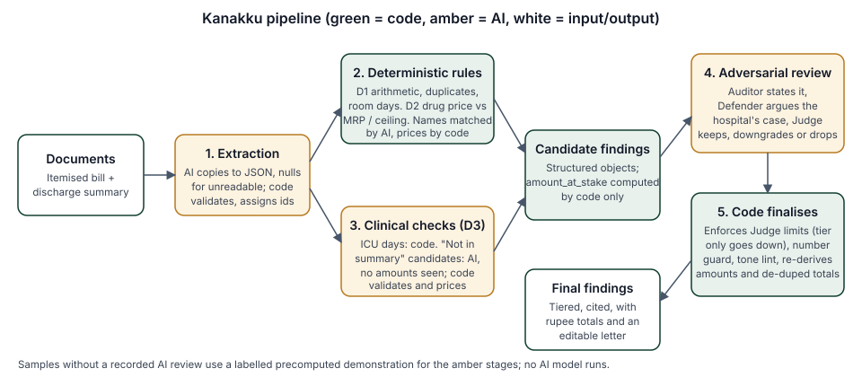
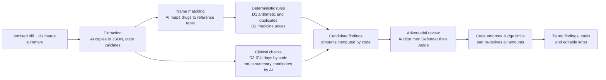

# Kanakku

**Upload your hospital bill. Kanakku finds the charges worth questioning, shows the evidence, and anticipates the hospital's reply.**

Kanakku is an adversarial AI bill reviewer for patients in India. It reads an itemised inpatient bill and the discharge summary, checks them with deterministic code, compares charges with the clinical notes, then has an Auditor, a Defender (the hospital's best explanation) and a Judge argue every finding before the patient sees it. The output is a tiered list of charges to question, with code-computed rupee amounts and sources, and an editable letter to the billing desk.

> **Synthetic data only.** Every bill, patient and hospital in this repository is fictional (`data/synthetic/`, labelled "Synthetic data" in the UI). The reference drug table is hand-curated and small (16 rows, 4 verified). Not tested on real bills.

## Disclaimer

Kanakku helps patients **question and clarify** charges with the hospital's billing desk. It is an informational tool, **not** legal, medical, financial or insurance advice. Its findings are charges to question, not conclusions that anyone acted improperly, and it cannot establish that a charge is wrong; only the hospital's records can. Reference prices and benchmarks are not legal limits. For disputes, consult a qualified professional or the relevant consumer or insurance grievance channel.

## Problem and target users

Itemised hospital bills run to dozens of lines. Patients and families, often in stressful circumstances, rarely have the time or the expertise to check the arithmetic, medicine prices, bed-days and whether each service appears in the clinical record. Kanakku is built for:

- **Patients and families** in India who have an itemised inpatient bill and discharge summary and want to know what to ask the billing desk.
- **Patient advocates and helpline volunteers** who review bills for others (an intended use; not validated).

## Features

- Reads an itemised bill and discharge summary (PDF or photo) into a checked, structured form; anything unreadable is marked, never guessed.
- **Three detectors**: arithmetic and duplicates (D1), medicine price vs printed MRP / reference MRP / NPPA ceiling price (D2), bill vs discharge summary (D3).
- **Rebuttal Engine**: Auditor, Defender and Judge per finding. Code limits the Judge: a tier can only go down, an amount never changes, a rule-proven finding is dropped only on a data error.
- **Tiered findings** (Provable / Ask about this) with line items, evidence computed by code and source citations; dropped findings stay visible for transparency.
- **Editable dispute letter** built by code from the findings you tick; print or save as PDF. Sample letters are marked "not for sending".
- **Honest status**: live, recorded and precomputed-demonstration results are labelled differently; partial audits and skipped checks are listed; a failed audit is never shown as a clean bill.
- Spend controls, upload limits and cache-only mode by default.

## Architecture





**Division of labour (non-negotiable):** code does all arithmetic, thresholds, table lookups and duplicate detection; the model does extraction, name matching, clinical-consistency reasoning, the debate and wording. The model never produces a rupee figure: a **number guard** rejects any amount or percentage that code did not supply.

| Step (UI label) | Route | Who does it |
|---|---|---|
| Reading bill | `POST /api/extract` (uploads) then `POST /api/normalize` | Model copies documents into JSON with explicit nulls; code assigns line ids, reconciles dates and validates. Model maps drug names to the reference table; code rejects unknown ids. |
| Matching prices | `POST /api/rules` | Code only: D1 and D2. |
| Checking clinical notes | `POST /api/clinical` | D3: ICU days by code; "not in summary" candidates proposed by the model (it never sees a rupee amount), validated and priced by code. |
| Cross-examining findings | `POST /api/debate` (one step per call) | Auditor, Defender, Judge, constrained by code. |
| Totalling | `POST /api/finalize` | Code re-runs the rules on the server, re-derives every amount, applies Judge limits and the de-duplicated totals rule. |

Every model output is zod-validated, passes the number guard and tone lint, is retried once with the error, and otherwise fails with a clear message. Prompts are versioned files in `prompts/`.

## Technology stack

Next.js 16 (App Router, TypeScript), React 19, Tailwind CSS 4, zod, the official Anthropic SDK (server side only), Vitest. No database: JSON files in `data/` and `cache/`. Deployable to Vercel.

## Demo modes: what you are looking at

| Result label | What it means |
|---|---|
| **Live AI review** | Uploads only. The AI stages ran live on the documents (needs a key, models and `KANAKKU_CACHE_ONLY=0`). |
| **Recorded AI review** | A sample whose AI answers were recorded once (`npm run warm-samples`, costs API credit) and are replayed from `cache/` with re-validation. No model is called during the run. |
| **Precomputed demonstration** | A sample on a deployment with no recorded review (the default in this repo). **No AI model runs.** Name matching, the summary comparison and the Auditor/Defender/Judge text are scripted from the sample's verified answer key; all amounts are computed by code during the run. Labelled on the landing page, progress view, result header, each finding and the letter. |
| **Partial audit** | A required stage did not run (for example a cold recorded cache). Listed in an amber panel; findings affected show "Not cross-examined". |
| **Checks skipped** | Individual lines code could not check honestly (medicine not in the table, unit unclear). Listed under the findings. |

A sample is marked "All stages ran" only when name matching, the summary comparison and the cross-examination of every finding completed.

## Install and run locally

Requires Node.js 20.9 or newer.

```bash
npm install
cp .env.example .env.local     # keep KANAKKU_CACHE_ONLY=1 (the default): no API key needed
npm run dev                    # http://localhost:3000
```

On Windows PowerShell use `copy .env.example .env.local`.

## Demo instructions (no API key, no cost)

1. `npm run dev`, open http://localhost:3000.
2. Click **Try the synthetic demo bill**. The progress view shows five stages; step notes say "demonstration script, no AI model".
3. Results: **₹7,931.44** to question (Provable ₹1,581.44, Ask ₹6,350.00), 6 findings, 1 dropped. Open a finding to see Finding / Hospital would say / Our counter.
4. Untick a finding: the bar and letter total update. Edit the letter, then change the selection: the letter is marked out of date and printing is disabled until you rebuild.
5. Run the other samples: the clean bill shows **₹0.00** (its one candidate is explained by the summary and dropped); the third shows ₹21,138.15 with one dropped.

Uploads are off in this mode and the page says why. A step-by-step 90-second script is in `docs/DEMO_SCRIPT.md`.

## Configuration

| Variable | Purpose |
|---|---|
| `ANTHROPIC_API_KEY` | Server-side only. Anthropic API billing is separate from a Claude.ai (Pro) subscription. |
| `MODEL_EXTRACT`, `MODEL_REASON` | Model ids. Suggested: `claude-haiku-5-5` (extraction, normalization) and `claude-opus-5-5` (clinical check, debate); `claude-sonnet-5-5` is a cheaper reasoning option. Confirm on the Anthropic "Models overview" page. |
| `KANAKKU_CACHE_ONLY` | Live calls happen only when this is exactly `0`. Unset or `1` = cache-only (safe default for a public demo). |
| `KANAKKU_MAX_CALLS_PER_RUN` (45), `KANAKKU_MAX_TOKENS_PER_RUN` (250000) | Per-audit budget. |
| `KANAKKU_MAX_TOKENS_PER_DAY` (2000000) | Per server instance per UTC day. |
| `KANAKKU_MAX_RUNS_PER_HOUR` (3) | New live audits per client IP per hour. |
| `KANAKKU_MAX_OUTPUT_TOKENS` (4000), `KANAKKU_TIMEOUT_MS` (60000) | Per model call. |
| `KANAKKU_MAX_DEBATE_FINDINGS` (12) | Findings sent through the debate; the rest are shown un-debated, highest-value first are debated. |
| `KANAKKU_MAX_UPLOAD_MB` (4), `KANAKKU_MAX_PDF_PAGES` (8) | Upload limits. |
| `KANAKKU_CACHE_DIR` | Optional; defaults to `./cache`. |

### Cost protections

1. Samples never call a model, in code, whatever the env says. They replay a recorded AI review when one is deployed, otherwise they use the labelled precomputed demonstration (no API credit either way).
2. Uploads are off unless `KANAKKU_CACHE_ONLY=0` and the key and both models are set; the UI explains why when they are off.
3. Per-audit call and token budgets, per-IP hourly audit limit, daily token cap, `max_tokens` and timeout on every call, one SDK retry for transient errors plus one validation retry, debate capped per audit and stopped early on budget, rate-limit or configuration errors.
4. These guards live in server memory, so several serverless instances each get their own counters. **Set a monthly spend limit in the Anthropic Console**; that is the hard cap.

A live audit of a bill like `bill-02-demo` makes roughly 2 extraction + 1 normalization + 1 clinical + 3 per finding (about 25 calls).

## Warm the sample cache (one-time, costs API credit)

```bash
npm run warm-samples                 # shows what it would do, spends nothing
npm run warm-samples -- --yes        # runs all three samples live (about 45 calls), writes cache/ and cache/manifest.json
npm run eval                         # replays the samples from cache only and prints the evaluation table
git add cache && git commit -m "Warm sample cache"
```

The samples are pre-extracted (their truth JSON is what a perfect extractor returns), so warming covers normalization, the clinical check and the debate. `cache/manifest.json` records which models produced the cache; sample runs replay with those models even on a deployment with no key. Warm all three samples with the same models. Review the eval table: it reports candidates, kept and dropped separately, seed recall, traps dropped (target 3) and decoys raised (target 0).

## Test

```bash
npm test                             # vitest; no network, no API key
npm run typecheck
npm run build
npx tsx scripts/check-fixtures.ts    # fixture, answer-key and reference-table consistency
npx tsx scripts/validate-table.ts    # reference table schema
```

Pipeline tests use a scripted model driven by the answer keys, so they check plumbing and code-enforced rules (ids, caps, tier enforcement, totals, partial results, budgets, demonstration labelling), not real model quality. `tests/demo.test.ts` covers the demonstration path: the clean sample shows nothing to question, the three traps are dropped, amounts equal the answer keys, and a result is never marked complete when a stage did not run.

## Deploy (Vercel)

1. Import the GitHub repo in Vercel (framework: Next.js; build `npm run build`).
2. Set environment variables. For a public demo: `KANAKKU_CACHE_ONLY=1` and no key (samples run as the precomputed demonstration or replay the recorded review, uploads are off). To allow uploads: add the key, both models and `KANAKKU_CACHE_ONLY=0`, keep the spend-guard defaults, and set a Console spend limit.
3. `next.config.mjs` bundles `prompts/`, `cache/` and `data/synthetic/` into the API functions. Each route sets `maxDuration = 60` (VERIFY against your plan's function limits).

## Decisions and deviations from SPEC.md

- **Letter**: built by code, not by the `letter.v1` model prompt, and printed via the browser (Save as PDF) instead of `pdf-lib`. No extra model call or dependency, no ₹-glyph font problem, and it cannot introduce a figure.
- **D3-M1 (ICU days)** is computed by code directly; model ICU candidates are ignored. It is a pure numeric comparison, and this keeps it running when the model fails.
- **Debate** runs one step per request (`/api/debate` with `step`) so each request makes at most one model call and stays under serverless time limits.
- **Disk cache** holds only the synthetic samples (written by the warm script). Uploaded documents are cached in memory only, so a real bill can never be committed.
- **Additive schema fields**: `BillExtraction.extraction_quality` (unreadable lines, missing rates/dates/total, so checks that cannot run honestly are skipped and logged), `Finding.review` and `Finding.enforcement_notes`, `PipelineResult.warnings` and `clinical_check`.
- **Precomputed demonstration path** (`src/lib/demo.ts`, `data/demo/demo_review.json`): when no recorded AI review is deployed, sample runs use scripted answers instead of a model. Which findings exist and whether each is kept or dropped come from the verified fixture manifests; wording is hand-written; every figure is filled in by code. It goes through the same schema, number-guard, tone and Judge-rule checks, and is labelled everywhere (see below).
- **Dependency added**: `@anthropic-ai/sdk` (on the SPEC's approved list). No other runtime dependency.

## Limitations

- **Synthetic data only.** Not validated on real bills, real scans or real hospitals. No accuracy, savings or user figures exist and none are claimed.
- The default sample experience is a **precomputed demonstration**, not a live or recorded AI review. A recorded review needs `npm run warm-samples -- --yes` with your own key (costs API credit).
- Extraction accuracy on real scans is untested; the results page shows "Bill lines as read" so users can compare with the paper bill.
- Drugs outside the 16-row reference table are not priced (listed under "Checks skipped"). Only 4 rows are verified; reference values are not official.
- India only; inpatient itemised bills only; no insurance rebuttals, accounts or negotiation scripts.
- HEIC photos are rejected; PDFs with compressed page objects cannot be page-counted before upload.
- In-memory spend counters reset per serverless instance (set a Console spend limit).
- Not legal, medical or insurance advice.

## Submission materials

`docs/ARCHITECTURE.md`, `docs/DEMO_SCRIPT.md`, `docs/SLIDES.md`, `docs/SCREENSHOTS.md`, `docs/IMPACT_CLAIMS.md`.
